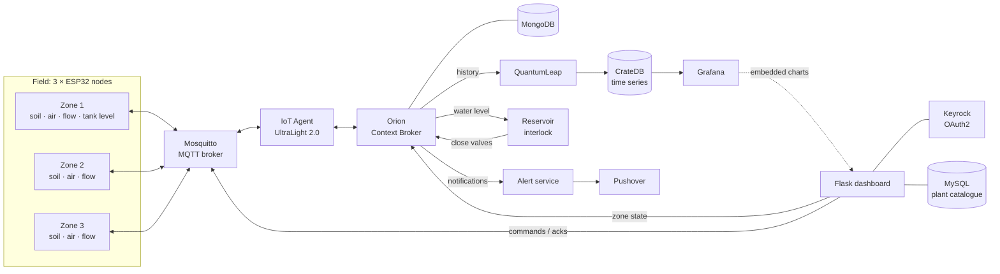

# Multi-Zone Smart Irrigation on FIWARE

**MSc thesis project · UniBIT, Sofia · defended October 2026 · grade Excellent (6/6)**

Three ESP32 field nodes measure soil and air conditions and water their own zones. Their data flows through a containerized FIWARE stack into a time-series database, dashboards, alerts and machine-learning experiments. The system ran in a real deployment for over three weeks and was load-tested up to 100 simulated zones.

> **Thesis:** *Design, Development and Experimental Evaluation of a Scalable IoT System for Smart Agriculture*
> („Проектиране, разработване и експериментална оценка на скалируема IoT система за интелигентно земеделие“)


---

## Highlights

- **Hardware and firmware:** 3 × ESP32 nodes, about 800 lines of C++ each. They read an RS485/Modbus soil probe (moisture, temperature, EC, pH), DHT air sensors, a flow meter and a reservoir level probe, and they drive zone valves plus a shared pump.
- **Safe autonomous irrigation:** pulse-and-soak control with hysteresis, dry-run detection from the flow meter, a reservoir cut-out, a 10-minute hard cap per watering, a 10 L daily cap, a morning watering window, a watchdog and a 1-hour safety lockout. Thresholds are stored in flash (NVS) and changed remotely.
- **FIWARE data pipeline:** MQTT (UltraLight 2.0) → IoT Agent → Orion Context Broker → QuantumLeap → CrateDB → Grafana, all running in Docker Compose.
- **Web dashboard (Flask):** OAuth2 login through FIWARE Keyrock with Admin and Viewer roles, live zone state from Orion, embedded Grafana charts, MQTT commands with acknowledgements, and a plant catalogue (MySQL) that sets each zone's moisture band.
- **Supporting services:** a reservoir interlock that closes zones 2 and 3 when zone 1's tank runs low, and an alert service that sends Pushover notifications for dry soil, out-of-range air temperature and low water, with hysteresis and cooldowns.
- **Experimental evaluation:** 24 days of real field data, a load test with up to 100 simulated zones, and soil-moisture prediction with LightGBM plus online learning with River.

## Architecture



### Hardware per node

| Part | Purpose |
|---|---|
| ESP32-32U DevKit | Node controller, Wi-Fi |
| SN3002 soil probe (RS485, Modbus RTU) | Soil moisture, temperature, EC, pH |
| DHT22 (zones 1–2), DHT11 (zone 3) | Air temperature and humidity |
| YF-B2 flow meter | Delivered volume, dry-run detection |
| Analog level probe (zone 1 only) | Reservoir water level |
| DS3231 RTC | Time for the watering window and the daily cap |
| 4-channel relay board | Zone valves and the shared pump |

## Results

### Field deployment (7–31 August 2026)

- **42,727 readings** from 3 zones, published every 2 minutes (every 30 s while watering).
- **82–83 % completeness** against that schedule. The longest gap was a ~46-hour outage.


*Soil moisture per zone over the deployment (axis labels in Bulgarian).*

### Scalability (load test on a single server)

Simulated zones each published every 10 s with random jitter. Latency was measured from the MQTT publish until the value was visible in Orion and in CrateDB, with 100 ms polling resolution.

| Zones | Publish → Orion (p50 / p95) | Publish → CrateDB (p50 / p95) | Probe timeouts |
|---:|---:|---:|---:|
| 3 | 115 / 118 ms | 0.65 / 1.0 s | 0 |
| 10 | 115 / 118 ms | 0.43 / 1.2 s | 0 |
| 25 | 115 / 118 ms | 0.43 / 1.4 s | 0 |
| 50 | 114 / 119 ms | 0.22 / 4.1 s | 0 |
| 100 | 85.7 / 88.3 s | 84.6 / 88.3 s | 461 of 1,176 (39 %) |

At 50 zones, about 200 times the message rate of the real deployment, the stack ran with no timeouts. At 100 zones the broker still acknowledged messages in about 1 ms, but latency to Orion jumped to about 86 s and 39 % of probes never reached CrateDB within the timeout.


### Machine learning

The task is to predict whether a zone's soil moisture will fall below its minimum within the next 6 hours. Training and test data are split chronologically (70 / 30), not shuffled, so the model never sees the future.

| Model | Dataset | Accuracy | ROC-AUC | PR-AUC | F1 |
|---|---|---:|---:|---:|---:|
| LightGBM | Real field data (29.5k train / 12.6k test) | 0.935 | 0.987 | 0.691 | 0.360 |
| LightGBM | Synthetic (10 zones × 120 days) | 0.893 | 0.958 | 0.964 | 0.883 |

Positive cases are rare in the real data (7 % of the test set), which is why F1 is much lower than ROC-AUC there. Online models (Adaptive Random Forest, ADWIN drift detection and Half-Space Trees anomaly detection, all from River) are evaluated in [`smart-agri/chapter 3/`](smart-agri/chapter%203/).

## Engineering decisions

- **Pulse-and-soak instead of "water until wet".** Soil moisture reacts minutes after watering, so a node gives a fixed 2 L dose, waits 30 minutes and measures again. Watering until the sensor reads wet would overwater.
- **Reservoir probe on GPIO34.** It moved off GPIO15 because ESP32 ADC2 pins can't be read while Wi-Fi is on. That also freed a strapping pin that was breaking firmware uploads.
- **Shared pump on an open-drain wired-OR line.** Any zone can switch the pump on without the nodes' outputs fighting each other.
- **The interlock only ever closes valves.** Clearing it can never start an unexpected watering.
- **Separate latency stages in the load test.** Measuring publish → Orion and publish → CrateDB separately shows which part of the pipeline is the bottleneck.

## Repository layout

| Path | Contents |
|---|---|
| [`arduino firmware/zone_1…3/`](arduino%20firmware/) | ESP32 firmware for each zone (Arduino C++) |
| [`smart-agri/docker-compose.yml`](smart-agri/docker-compose.yml) | Full stack: Orion, MongoDB, Mosquitto, IoT Agent, CrateDB, QuantumLeap, Keyrock, MySQL, Grafana, dashboard, interlock |
| [`smart-agri/dashboard/`](smart-agri/dashboard/) | Flask dashboard: OAuth2 login, MQTT commands, plant catalogue |
| [`smart-agri/interlock/`](smart-agri/interlock/) | Reservoir interlock service |
| [`smart-agri/alerts.py`](smart-agri/alerts.py) | Pushover alert service fed by Orion notifications |
| [`smart-agri/grafana/`](smart-agri/grafana/) | Provisioned CrateDB data source and zone dashboard |
| `smart-agri/*.sh` | Provisioning for IoT Agent devices, the QuantumLeap subscription and Keyrock (app, roles, users) |
| [`smart-agri/chapter 3/`](smart-agri/chapter%203/) | Evaluation scripts, exported data, result tables and figures (in Bulgarian, the thesis language) |

## Running it

The stack is a lab setup for a single Ubuntu server.

```bash
cd smart-agri
docker compose up -d       # reads a .env file, see the variables below
./ql_subscription.sh       # Orion → QuantumLeap history subscription
./keyrock_setup.sh         # OAuth2 app, Admin/Viewer roles and demo users
```

- **`.env` variables:** `MONGO_ROOT_PASSWORD`, `MYSQL_ROOT_PASSWORD`, `GRAFANA_ADMIN_PASSWORD`, `FLASK_SECRET_KEY`, `KEYROCK_CLIENT_ID`, `KEYROCK_CLIENT_SECRET`, `GRAFANA_PANEL_URL`. `keyrock_setup.sh` prints the client ID and secret to add.
- **Zone devices** are registered in the IoT Agent with their attributes and commands. `prov23.sh` does this for zones 2 and 3.
- **Nodes** are flashed from `arduino firmware/` after setting Wi-Fi, the MQTT host and the API key in the configuration block at the top of each sketch.
- **Ports:** Grafana `:3000`, dashboard `:5050`, Orion `:1026`, Keyrock `:3005`, CrateDB admin `:4200`.

**Security note:** this is a LAN demonstrator. MQTT accepts anonymous clients, CrateDB runs without authentication, and Grafana allows anonymous viewing so its charts can be embedded. A production deployment would add TLS, broker authentication and a single HTTPS origin behind a reverse proxy.

## Author

**Konstantin Kapanov**, MSc in Software Engineering, University of Library Studies and Information Technologies (UniBIT), Sofia
Supervisor: Chief Assist. Prof. Lyubomir Gotsev, PhD

[LinkedIn](https://www.linkedin.com/in/konstantin-kapanov) · [GitHub](https://github.com/kokito741)
